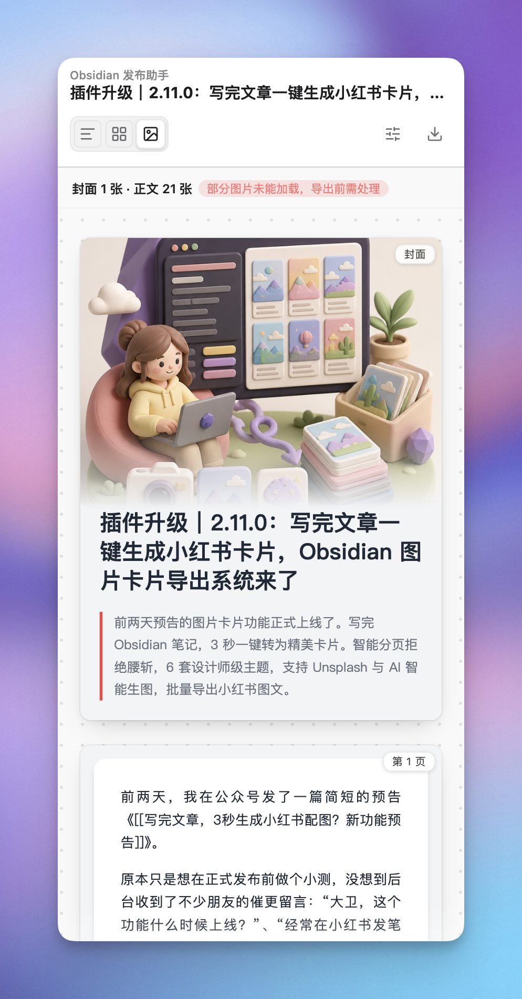
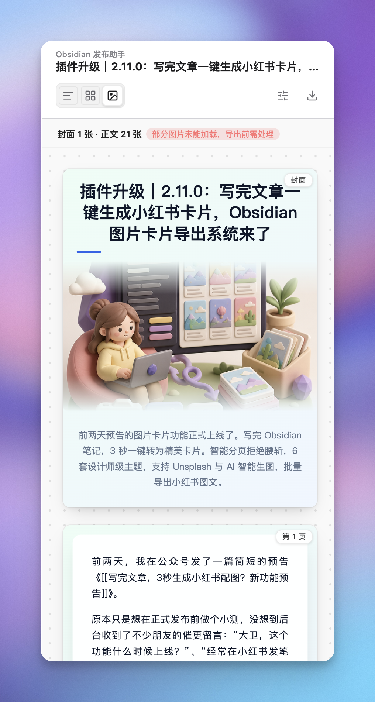
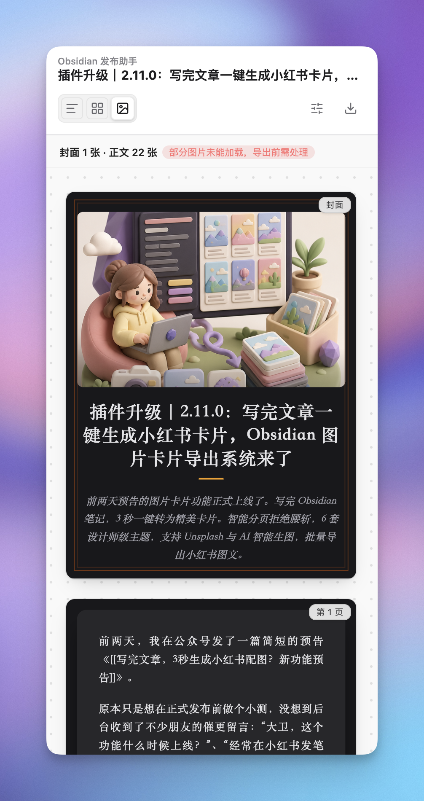
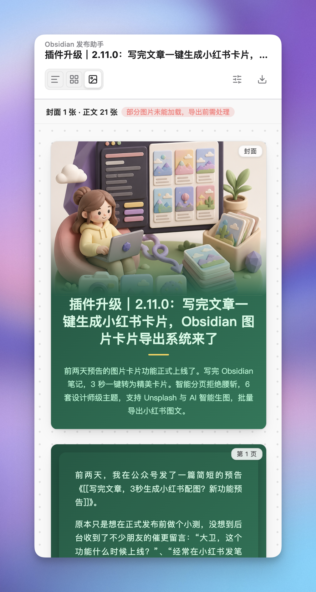
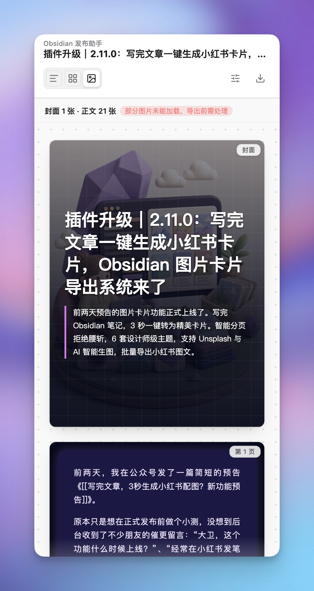
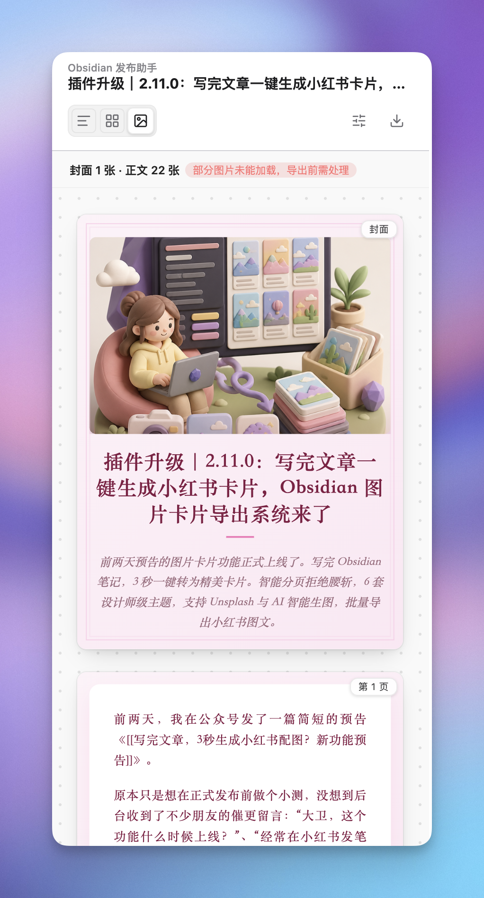
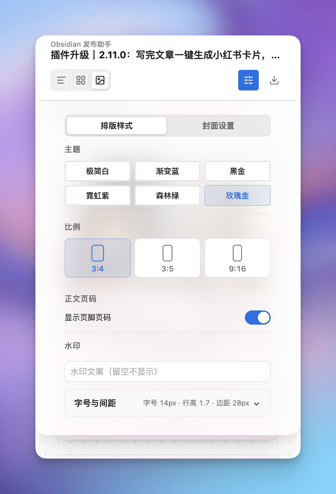
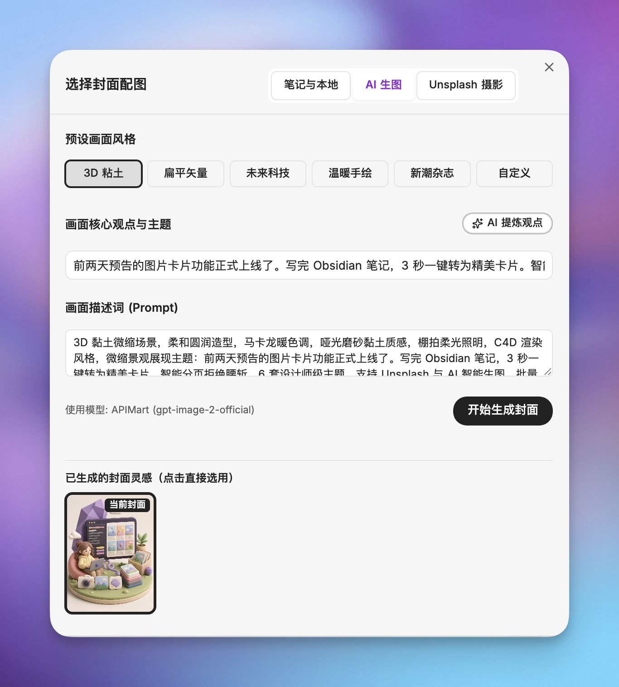
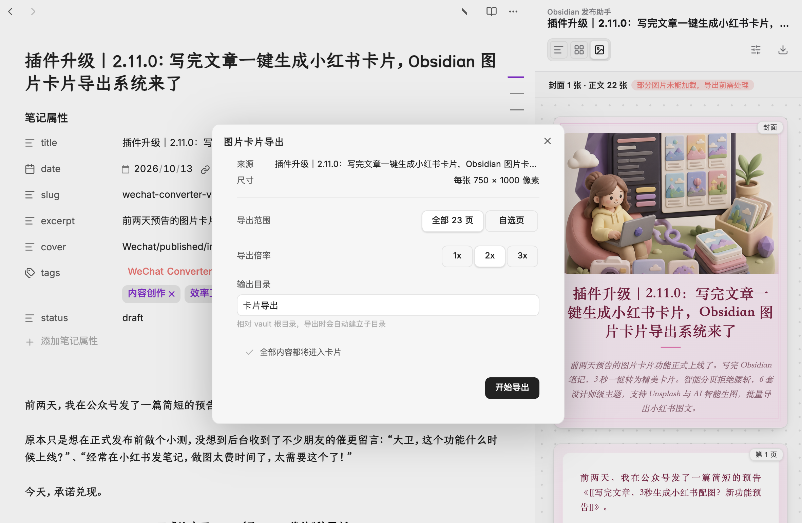

[简体中文](https://github.com/DavidLam-oss/obsidian-wechat-converter/blob/main/README.md) | English

# 📝 Wechat Converter for Obsidian

**Technical writing with elegance and pure focus. Longform formatting · Multi-page image cards · Cross-platform publishing.**

An all-in-one publishing and formatting plugin for Obsidian. It not only solves the "last mile" problem of formatting notes for WeChat Official Accounts and Feishu Cloud Documents, but now also introduces the **Multi-page Image Card Studio (Card Mode)** and one-click multi-platform distribution to Zhihu, Juejin, Xiaohongshu, and CSDN via the companion browser extension.


[](#support)

> ☕ **If this plugin saves you time formatting or publishing notes, consider [👉 buying the author a coffee](#support) to support ongoing development!**

---

## 🌟 Three Core Publishing Forms

Switch effortlessly between three publishing modes at the top of the converter panel:

```
                    ┌─ 📱 Longform Article ──► WeChat Official Account (Rich HTML / Direct Draft Sync)
                    │
Obsidian Notes ─────┼─ 🎴 Knowledge Cards ──► Multi-page Image Cards (Xiaohongshu / Moments / Social)
                    │
                    └─ 🚀 Multi-Platform ────► Feishu Docs + Browser Extension to Zhihu/Juejin/CSDN
```

| Mode | Best For | Core Highlights |
| :--- | :--- | :--- |
| **📱 Longform Article** | In-depth guides, tech articles, tutorials | Sub-millisecond mobile preview, wash-resistant LaTeX SVG formulas, rasterized Mermaid diagrams, Mac-style code blocks, direct sync to WeChat drafts. |
| **🎴 Knowledge Cards** *(✨ New)* | Xiaohongshu posts, WeChat Moments, Twitter/X cards | 6 curated themes, 3 social aspect ratios (3:4 / 3:5 / 9:16), independent cover picker (AI generation / Unsplash / local illustrations), lossless batch export. |
| **🚀 Multi-Platform** | Team knowledge base, cross-network distribution | Native Feishu docx OpenAPI sync with in-place overwrite; seamless distribution to Chinese blogging platforms via browser extension without storing credentials in Obsidian. |

---

## 🔥 Killer Features

### 1. 🎴 Multi-Page Image Card Studio (Card Mode)

Turn your Markdown notes into gorgeous multi-page social card stacks with zero design friction.

#### 🎨 6 Curated Themes
Designed with rich contrast and typography for social sharing:

<table>
  <tr>
    <td align="center" width="33%"><b>Simple White</b><br/></td>
    <td align="center" width="33%"><b>Gradient Blue</b><br/></td>
    <td align="center" width="33%"><b>Dark Gold</b><br/></td>
  </tr>
  <tr>
    <td align="center" width="33%"><b>Forest Green</b><br/></td>
    <td align="center" width="33%"><b>Neon Purple</b><br/></td>
    <td align="center" width="33%"><b>Rose Gold</b><br/></td>
  </tr>
</table>

#### 🛠️ Comprehensive Card Studio
- **Typography & Layout Tokens**: Freely customize aspect ratio (3:4 / 3:5 / 9:16), font scale, line height, padding, page numbers, and custom watermark text.
- **4 Cover Layout Presets**: Text-only, Adaptive Theme layout, Atmospheric Full-Cover, and Poster Full-Bleed.
- **Cover Media Picker**:
  - Auto-selects the first meaningful image in the note while ignoring functional QR codes or badges.
  - Direct search via Unsplash with bilingual keyword support.
  - Built-in AI generation workshop to summarize key takeaways and generate stylized imagery (3D Clay, Cyberpunk, Warm Sketch, etc.).
- **High-Fidelity Off-screen Export**: One-click copy of individual cards directly to clipboard, or batch export all pages into PNG files without disk residue or cloud dependency.

<table>
  <tr>
    <th align="center">Layout Tokens & Cover Settings</th>
    <th align="center">AI Illustration Workshop</th>
    <th align="center">Batch Export Modal</th>
  </tr>
  <tr>
    <td align="center"></td>
    <td align="center"></td>
    <td align="center"></td>
  </tr>
</table>

---

### 2. 📱 WeChat Longform Publishing & Direct Draft Sync

- **Sub-millisecond Real-time Preview**: Faithful iPhone frame preview matching the exact reader perspective on mobile devices, with bidirectional synchronized scrolling.
- **Wash-Resistant Formatting**:
  - **LaTeX Math Formulas**: Renders `$E=mc^2$` and `$$...$$` into sharp vector SVG graphics that cannot be stripped by WeChat's editor.
  - **Mermaid Diagrams**: Auto-rasterized to PNG upon export to bypass WeChat's SVG payload limits while preserving original diagram themes.
  - **Mac-style Code Blocks**: Pixel-perfect window header and line numbers matching the preview.
  - **Scrollable Containers**: Wide tables and image blocks (`> [!image-swipe]`) remain horizontally scrollable on mobile.
- **Direct WeChat Draft Box Sync**:
  - Supports multiple WeChat accounts (up to 5).
  - High-concurrency image upload with automatic retry and idempotency protection.
  - Direct cover selection from the WeChat permanent material library.
  - Subsequent syncs overwrite existing drafts to keep the backend tidy.

<table>
  <tr>
    <th align="center">Phone Simulation Mode</th>
    <th align="center">Math & Code Rendering</th>
    <th align="center">WeChat Draft Sync</th>
  </tr>
  <tr>
    <td align="center"></td>
    <td align="center"></td>
    <td align="center"></td>
  </tr>
</table>

---

### 3. 📄 Feishu Cloud Document Sync

- One-click docx creation directly inside your designated Feishu folder.
- In-place overwrite sync maintains existing document URLs across edits.
- Fully preserves images, animated GIFs, Callouts, task lists, formulas, and diagrams.

---

### 4. 🌐 Multi-Platform Distribution via Companion Extension

- Send articles to Zhihu, Juejin, CSDN, and Xiaohongshu via the companion browser extension.
- Uses existing browser sessions; **Obsidian never embeds platform logins or touches user cookies**.

---

## 🚀 Quick Start

1. **Open Plugin**: Click the 🪄 icon on the left ribbon, or press `Cmd/Ctrl + P` and search for `Open Wechat Converter`.
2. **Select Mode**:
   - For WeChat articles: Use **Longform Mode**, check the live preview, then click **[📋 Copy to WeChat]** or **[🚀 Sync Draft]**.
   - For social cards: Switch to **Card Mode**, customize theme & ratio, then copy individual cards or click **[Export Cards]**.
   - For Feishu or other platforms: Click **[Publish & Distribute]** to send drafts.

---

## 🛠️ Advanced Customization

<details>
<summary><b>🎨 Custom CSS</b></summary>

- Open Settings → **WeChat Official Account** → **Custom CSS**.
- Enter CSS directly or reference a Markdown / CSS note in your vault.
- Strictly isolated to standard article previews and drafts; does not interfere with Card Mode.
</details>

<details>
<summary><b>✍️ Chinese Punctuation Normalization</b></summary>

- Enable in the right-hand style settings panel.
- Strictly safe: transforms only during rendering and copy; **never mutates your source Markdown notes**.
- Automatically protects code blocks, inline code, URLs, math, and function calls.
</details>

<details>
<summary><b>🖼️ WeChat Image Post Mode</b></summary>

- Switch to **Image Post Mode** at the top for photo-centric updates (up to 20 images + plain text caption).
- Reorder and curate images before directly syncing to WeChat draft box.
</details>

<details>
<summary><b>🔧 Proxy Setup for WeChat IP Whitelisting</b></summary>

Resolve dynamic IP changes with either the built-in official relay or a self-hosted Cloudflare Worker. See [PROXY_GUIDE.md](./PROXY_GUIDE.md) for step-by-step setup instructions.
</details>

---

## 📦 Installation

### Method 1: Community Plugins (Recommended)
1. Open Obsidian **Settings** → **Community plugins**.
2. Turn off **Safe mode**, click **Browse**, and search for `Wechat converter`.
3. Click **Install**, then **Enable**.

### Method 2: BRAT (Beta Testing)
1. Install the BRAT plugin.
2. Add repository: `DavidLam-oss/obsidian-wechat-converter`.

### Method 3: Manual Installation
1. Download `obsidian-wechat-converter.zip` from [GitHub Releases](https://github.com/DavidLam-oss/obsidian-wechat-converter/releases).
2. Extract into `.obsidian/plugins/obsidian-wechat-converter/`.
3. Reload plugins and enable.

---

## ☕ Support & Sponsor <a id="support"></a>

Wechat Converter will remain free and open source. If it saves you time, consider buying the author a coffee!

<div align="center">
  <table>
    <tr>
      <td align="center" width="240">
        <br />
        <sub><b>WeChat Pay</b></sub>
      </td>
      <td align="center" width="240">
        <br />
        <sub><b>Alipay</b></sub>
      </td>
    </tr>
  </table>
  <p><i>❤️ Thank you to every creator supporting this project!</i></p>
</div>

---

## 👨‍💻 Author

**DavidLam (林小卫很行)** — Creator passionate about personal productivity, PKM, and technical writing.

- 🌐 **Personal Website**: [xiaoweibox.top](https://xiaoweibox.top/)
- 📚 **Obsidian Column**: [Obsidian In-Depth Practices](https://xiaoweibox.top/blog/obsidian) — Systemic guides on building personal knowledge bases (PKM), advanced workflows, and productivity setups.
- 📢 **WeChat Official Account**: **林小卫很行** — Sharing Obsidian power-user workflows, AI-assisted writing, and cutting-edge productivity tools.

<div align="center">
  <br />
  <sub><b>Scan to follow Official Account "林小卫很行"</b><br/>For Obsidian advanced workflows, AI writing tips, and plugin release updates</sub>
</div>

---

## 🤝 Contributing & License

- Issues and Pull Requests are welcome via [GitHub Issues](https://github.com/DavidLam-oss/obsidian-wechat-converter/issues).
- Released under the [MIT License](LICENSE).
