简体中文 | [English README](https://github.com/DavidLam-oss/obsidian-wechat-converter/blob/main/README.en.md)

# 📝 微信公众号排版转换器 (Wechat Converter)

**让技术写作回归优雅与纯粹。长文排版 · 知识卡片 · 多平台同步，为创作者打造的全能发布助手。**

一款专为 Obsidian 打造的多合一排版与全平台发布增强插件。不仅解决了 Obsidian 到微信公众号文章与飞书云文档排版的“最后一公里”，更重磅推出了**多页图文卡片导出（Card Mode）**，并支持通过浏览器插件一键分发到知乎、掘金、小红书、CSDN 等平台。让您专注于内容创作，告别繁琐的格式调试与多端搬运。


[](#support)

> ☕ **开源不易，如果这个插件帮您节省了排版与内容发布的时间，欢迎 [👉 扫码请作者喝杯咖啡](#support) 支持项目持续迭代！**

---

## 🌟 三大核心创作与发布形态

在转换器顶部，您可以根据分发场景随心切换三种不同内容形态：

```
                    ┌─ 📱 长文排版模式 ──► 微信公众号文章（富文本复制 / 直连草稿箱）
                    │
Obsidian 笔记 ──────┼─ 🎴 知识卡片模式 ──► 多页高清图文卡片（小红书 / 朋友圈 / 社交分享）
                    │
                    └─ 🚀 多平台分发 ────► 飞书云文档 + 浏览器插件直达知乎/掘金/小红书/CSDN
```

| 模式 | 适用场景 | 核心亮点 |
| :--- | :--- | :--- |
| **📱 长文排版模式** | 微信公众号技术长文、深度报道、教程指南 | 毫秒级双模仿真预览、LaTeX 矢量公式抗清洗、Mermaid 原生转图、Mac 风格代码块、一键直连微信草稿箱 |
| **🎴 知识卡片模式** *(✨重磅)* | 小红书图文笔记、朋友圈九宫格、即刻动态、知识卡片 | 6 套高颜值预设主题、3 种社交比例（3:4 / 3:5 / 9:16）、封面独立选图（AI 生图 / Unsplash / 本地配图）、离屏高清无损批量切图导出 |
| **🚀 多平台分发** | 团队知识库沉淀、全网内容矩阵分发 | 飞书云文档 OpenAPI 深度同步（覆盖更新不改链接）；结合「Obsidian 发布助手」浏览器插件，免输密码一键推送到全网草稿箱 |

---

## 🔥 核心杀手级特性

### 1. 🎴 全新多页图文卡片模式 (Card Mode)

专为社交媒体（小红书、朋友圈、即刻、微博等）打造的高颜值卡片生成器。无需借助第三方设计工具，直接将当前 Markdown 笔记转换为整套精美排版的多页图片卡片。

#### 🎨 6 套精心调优的高级卡片主题
内置 6 款高饱和、高质感的预设主题，覆盖从极简白、科技渐变蓝到黑金暗调：

<table>
  <tr>
    <td align="center" width="33%"><b>极简白 · Simple White</b><br/>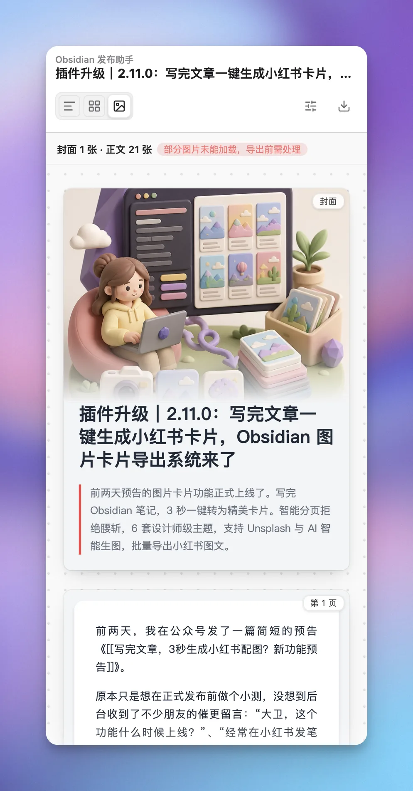</td>
    <td align="center" width="33%"><b>渐变蓝 · Gradient Blue</b><br/>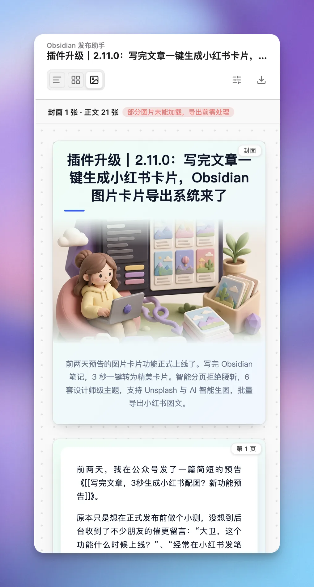</td>
    <td align="center" width="33%"><b>黑金 · Dark Gold</b><br/>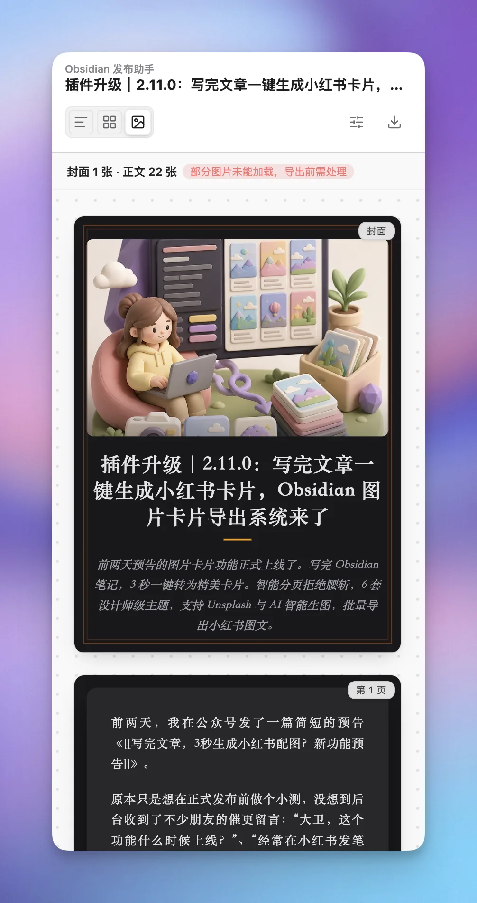</td>
  </tr>
  <tr>
    <td align="center" width="33%"><b>森林绿 · Forest Green</b><br/>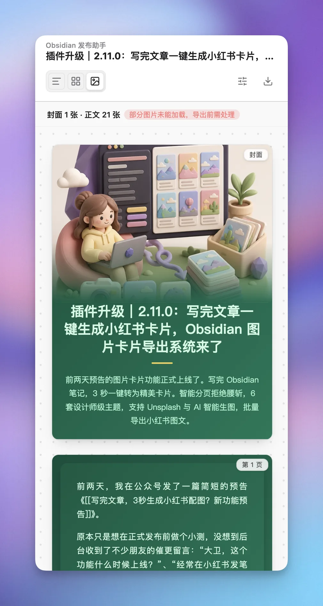</td>
    <td align="center" width="33%"><b>霓虹紫 · Neon Purple</b><br/>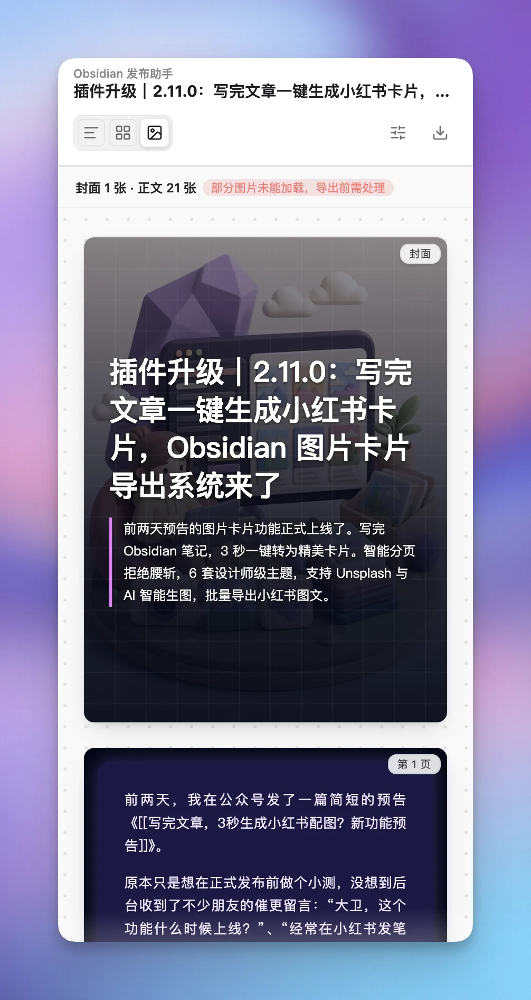</td>
    <td align="center" width="33%"><b>玫瑰金 · Rose Gold</b><br/>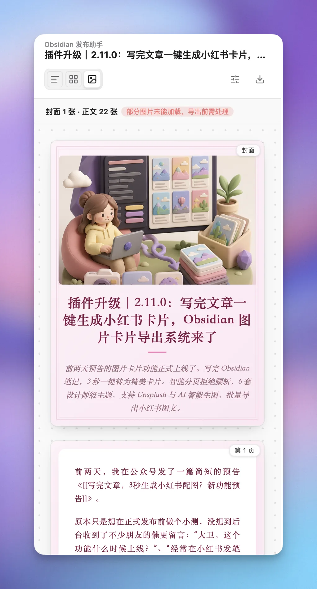</td>
  </tr>
</table>

#### 🛠️ 灵活的卡片工作台 & 独立选图
- **排版 Token 定制**：自由调整比例（3:4 小红书首选 / 3:5 舒展版 / 9:16 全屏）、字号、行高、内边距、页码开关与水印文本。
- **4 式封面预设**：纯文字排版、主题自适应版式、全屏意境大图、纯海报整页铺满。
- **独立选图工作台**：
  - **正文插图自动采纳**：自动提取正文首图，智能避开二维码、赞赏码等功能图片。
  - **Unsplash 图库直搜**：中英文海量高清大图随选随换。
  - **AI 智能生图工作台**：提炼文章核心观点，注入 3D 粘土、未来科技、温暖手绘等多种视觉风格，模拟生成并支持画廊多图对比。
- **高清离屏切图导出**：基于现代化离屏快照引擎，单张卡片一键复制到系统剪贴板（零磁盘写入），或多页逐页批量导出 PNG，严格安全无外链泄漏。

<table>
  <tr>
    <th align="center">排版 Token 与封面设置</th>
    <th align="center">AI 智能配图与生图工作台</th>
    <th align="center">有界逐页导出弹窗</th>
  </tr>
  <tr>
    <td align="center">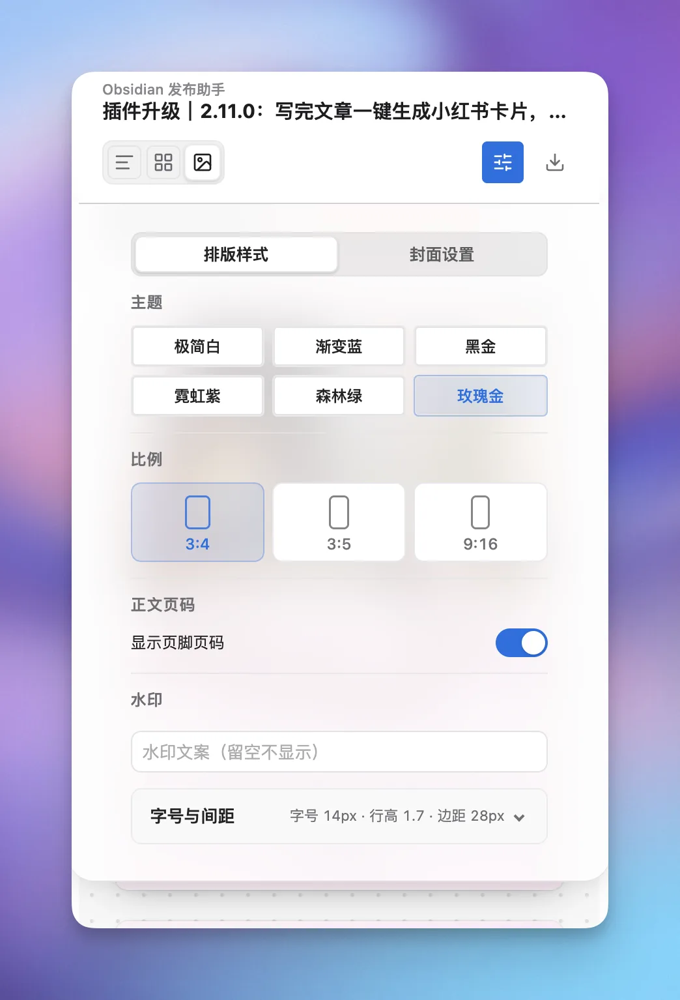</td>
    <td align="center">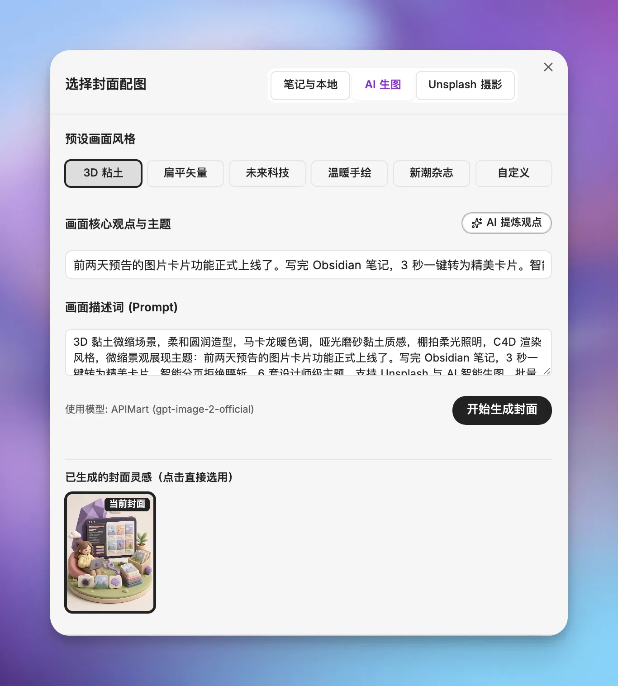</td>
    <td align="center">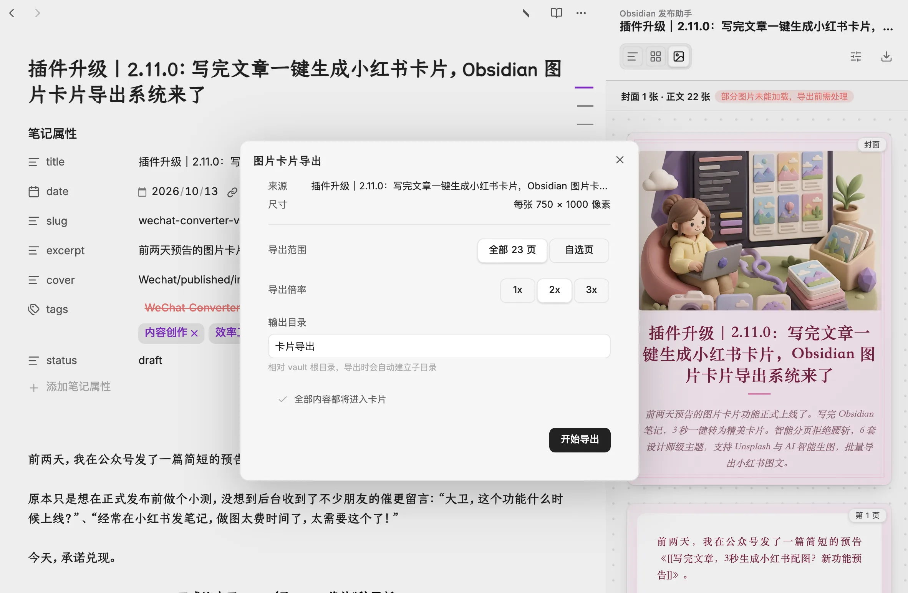</td>
  </tr>
</table>

---

### 2. 📱 微信公众号排版与官方草稿箱深度直连

彻底告别第三方格式化工具与编辑器排版错位，在 Obsidian 内部实现真正的“所见即所得”。

- **毫秒级实时双模预览**：
  - **手机仿真模式 (默认)**：提供 iPhone 边框与安全区视图，真实还原读者在手机微信中的第一视觉。
  - **双向同步滚动**：左侧编辑，右侧如影随形，精准对齐。
- **抗清洗渲染管线**：
  - **LaTeX 数学公式**：全面支持 `$E=mc^2$` 与 `$$...$$`，采用独家纯矢量 SVG 渲染，无论放大多少倍都清晰锐利，完美抵抗微信编辑器清洗。
  - **Mermaid 智能栅格化**：导出时自动将图表转为高清 PNG，保留原图配色，避开微信大尺寸 SVG 拦截。
  - **Mac 风格代码块**：精致的三色控制按钮与行号展示，复制到公众号后 1:1 分毫不差。
  - **横向滑动容器**：宽表格自动包裹横向滚动容器；支持 `> [!image-swipe]` 多图横向左右滑动展示。
- **一键直连微信草稿箱**：
  - 走微信官方 API，支持多账号快速切换（最多 5 个）。
  - 图片极速并发上传，断点重试与幂等防重设计。
  - 支持从微信永久素材库直接选封面，再次同步智能覆盖更新已关联草稿。

<table>
  <tr>
    <th align="center">手机仿真模式</th>
    <th align="center">数学公式与图表</th>
    <th align="center">一键同步草稿箱</th>
  </tr>
  <tr>
    <td align="center">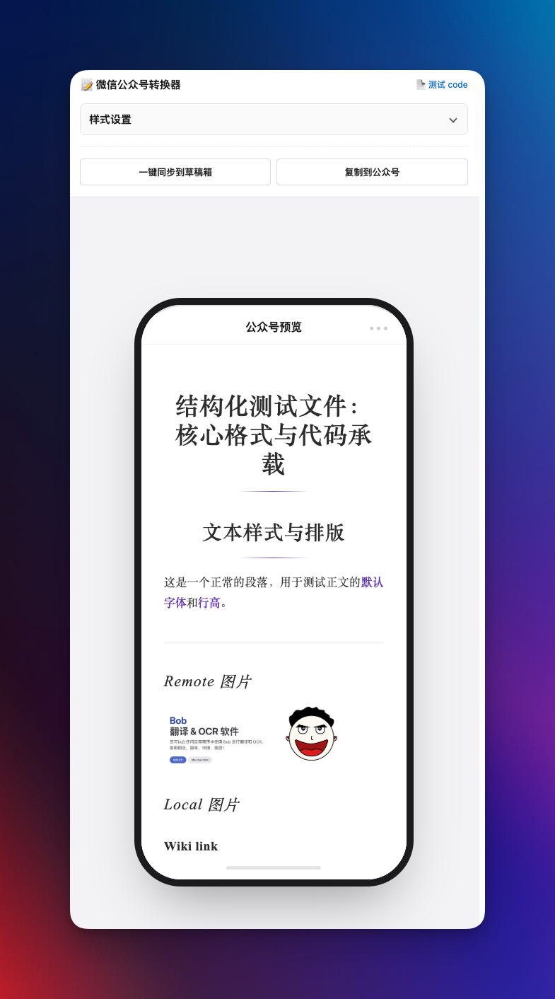</td>
    <td align="center">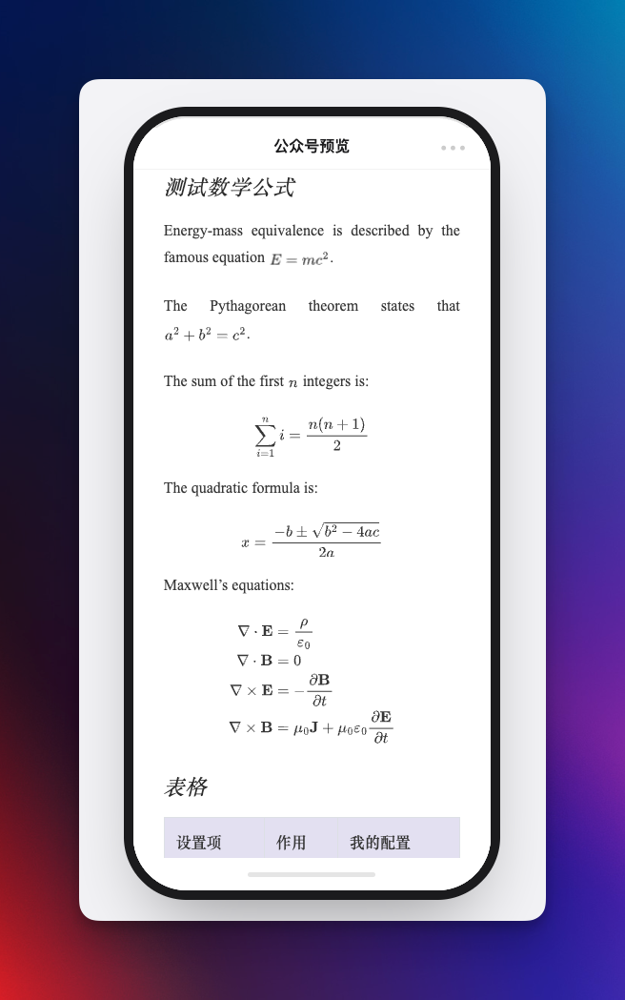</td>
    <td align="center">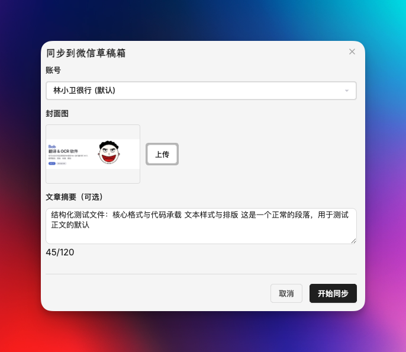</td>
  </tr>
</table>

---

### 3. 📄 飞书云文档原生发布

直接发布到飞书云文档，用于团队协作沉淀与长效知识管理。

- **一键同步到指定文件夹**：在插件内配置自建应用后，一键生成飞书 docx 文档。
- **覆盖更新不换链接**：再次同步同一笔记时，优先智能更新原文档，文档链接终生不变。
- **富媒体与语法全兼容**：完整保留本地图片、GIF 动图动画帧、Callout、任务列表、公式与图表。

<table>
  <tr>
    <th align="center">飞书应用与目录配置</th>
    <th align="center">发布与重新绑定弹窗</th>
    <th align="center">同步后的飞书文档效果</th>
  </tr>
  <tr>
    <td align="center"></td>
    <td align="center"></td>
    <td align="center"></td>
  </tr>
</table>

---

### 4. 🌐 多平台分发矩阵 (浏览器协同扩展)

一处写作，全网分发。通过配套的 **「Obsidian 发布助手」** 浏览器插件，让多平台分发轻而易举。

- **无感接管平台登录态**：知乎、掘金、CSDN、小红书等平台直接利用浏览器既有会话保存草稿，**Obsidian 不托管 Cookie，不内嵌第三方登录**，安全无忧。
- **统一发布中心**：在发布弹窗中勾选目标平台后直接投递，任务进度与重试在浏览器助手侧清晰掌控。

<table>
  <tr>
    <th align="center">选择分发目标</th>
    <th align="center">浏览器扩展状态</th>
    <th align="center">多平台任务中心</th>
  </tr>
  <tr>
    <td align="center"></td>
    <td align="center"></td>
    <td align="center"></td>
  </tr>
</table>

---

## 🚀 极简上手指南

1. **唤起插件**：点击 Obsidian 左侧 Ribbon 工具栏的 🪄 图标，或按下 `Cmd/Ctrl + P` 运行 `Open Wechat Converter`。
2. **选择模式**：
   - 需要发公众号长文：保持在 **「长文排版模式」**，右侧实时预览效果，满意后点击底部的 **[📋 复制到公众号]** 或 **[🚀 一键同步草稿箱]**。
   - 需要发社交图文：切换到 **「图片卡片模式」**，在右侧面板定制比例、主题与封面，点击卡片上的悬浮按钮单张复制，或点击底部 **[导出卡片]** 批量生成。
   - 需要分发多平台：点击 **[发布与分发]**，选择飞书云文档或勾选其他社交平台发送。

---

## 🛠️ 高级功能与定制

<details>
<summary><b>🎨 自定义 CSS (扩展与覆盖内置主题)</b></summary>

- 打开插件设置 → **微信公众号** → **自定义 CSS**。
- 支持直接填写 CSS 代码，或指定 Vault 内的 Markdown / CSS 笔记作为外部样式源。
- 样式安全隔离：自定义 CSS 仅作用于普通长文预览、复制与公众号文章草稿，严格与卡片模式、贴图模式隔离。
</details>

<details>
<summary><b>✍️ 中文标点标准化规则 (仅影响输出，保护源码)</b></summary>

- 开启位置：排版设置面板 → `正文标点标准化`。
- **严格安全**：仅在预览、复制与同步输出时进行替换，**绝不修改原始 Markdown 笔记**。
- **自动转全角**：常见英文标点 `, . : ? ! ; ( ) "` 会在中文语境下自动转换为标准中文标点。
- **技术场景智能保护**：自动避开行内代码、代码块、URL、邮箱、数学记号、函数调用（如 `foo(x, y)`）、浮点数与英文原句。
</details>

<details>
<summary><b>🖼️ 微信公众号独立贴图模式</b></summary>

- 在顶部切换到 **微信贴图模式**，适合图文配图类草稿（最多 20 张图片 + 纯文本文案）。
- 支持从当前正文、文档属性、本地文件或公众号永久素材库快速整理图片，自由拖拽排序。
- 确认标题与纯文本后，一键直连微信草稿箱。
</details>

<details>
<summary><b>🔧 微信 IP 白名单代理支持 (解决动态 IP 报错)</b></summary>

微信开放平台要求在公众号后台配置 IP 白名单。若你的网络经常变动（家庭宽带、移动热点、VPN），可以在设置中配置 API 代理：
- **官方中转**：支持直接使用免部署的官方中转 Token。
- **自建代理**：支持通过 Cloudflare Worker 自行部署，详细步骤请参见 [PROXY_GUIDE.md](./PROXY_GUIDE.md)。
</details>

<details>
<summary><b>🔐 隐私安全与权限保障</b></summary>

- 插件默认纯本地运行，不含任何远程遥测代码，不上传笔记内容。
- 系统剪贴板仅在用户主动点击“复制”按钮时单向写入，绝不读取剪贴板。
- 多平台登录态完全由浏览器负责，插件不存储任何第三方平台的账密与 Cookie。
</details>

---

## 📦 安装方式

### 方式一：社区插件市场安装（推荐 ⭐）
1. 打开 Obsidian 的 **设置 (Settings)** → **社区插件 (Community plugins)**。
2. 关闭 **限制模式 (Safe mode)**，点击 **浏览 (Browse)**。
3. 搜索 `Wechat converter` 或 `微信公众号排版转换器`，点击安装并启用。

### 方式二：BRAT 安装（尝鲜 Beta 版）
1. 安装并启用社区插件 BRAT。
2. 添加 GitHub 仓库：`DavidLam-oss/obsidian-wechat-converter`。

### 方式三：GitHub Releases 手动安装
1. 从 [GitHub Releases](https://github.com/DavidLam-oss/obsidian-wechat-converter/releases) 下载最新的 `obsidian-wechat-converter.zip`。
2. 解压后放入 Obsidian 仓库的 `.obsidian/plugins/obsidian-wechat-converter/` 目录中。
3. 重启 Obsidian 或在设置中刷新并启用插件。

---

## ☕ 支持与赞助 <a id="support"></a>

Wechat Converter 始终保持免费开源。如果它提升了您的写作与发布效率，欢迎请作者喝杯咖啡！

<div align="center">
  <table>
    <tr>
      <td align="center" width="240">
        <br />
        <sub><b>微信赞赏</b></sub>
      </td>
      <td align="center" width="240">
        <br />
        <sub><b>支付宝</b></sub>
      </td>
    </tr>
  </table>
  <p><i>❤️ 开源不易，感谢每一位支持项目持续迭代的创作者！</i></p>
</div>

---

## 👨‍💻 关于作者 (About Author)

**DavidLam (林小卫很行)** —— 一名热衷于探索知识生产力、AI 落地与技术写作的创作者与独立开发者。

- 🌐 **个人主页**：[xiaoweibox.top](https://xiaoweibox.top/) —— 记录技术探索、折腾心得与生活随笔
- 📚 **Obsidian 专栏**：[小卫的 Obsidian 深度实践](https://xiaoweibox.top/blog/obsidian) —— 与本插件深度配套，系统分享个人知识库（PKM）搭建、高阶工作流与提效秘籍
- 📢 **微信公众号**：微信扫码关注 **「林小卫很行」**，第一时间获取本插件更新动态、Obsidian 排版黑科技与前沿效率工具分享。

<div align="center">
  <br />
  <sub><b>扫码关注公众号「林小卫很行」</b><br/>获取更多 Obsidian 高阶工作流、AI 写作黑科技与插件更新动态</sub>
</div>

---

## 🤝 贡献与许可

- 欢迎提交 [Issue](https://github.com/DavidLam-oss/obsidian-wechat-converter/issues) 提出宝贵意见或 Bug 反馈。
- 本项目采用 [MIT License](LICENSE) 授权。
